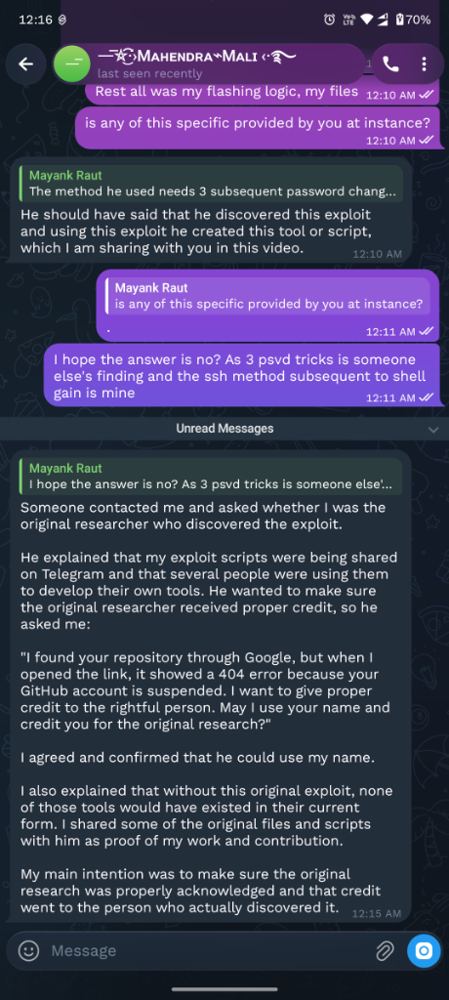
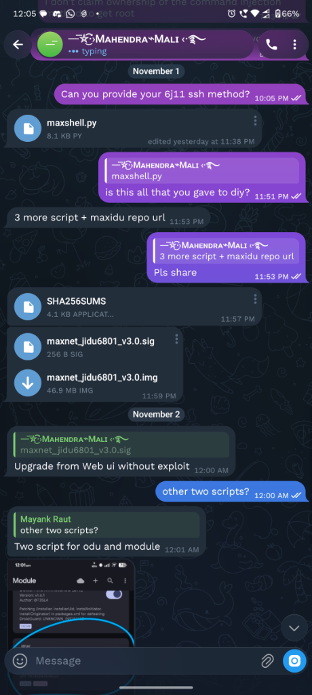
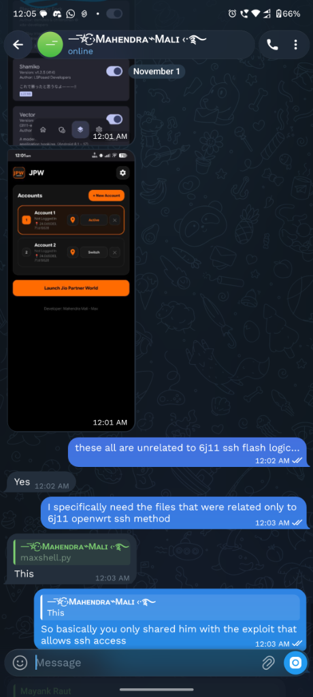
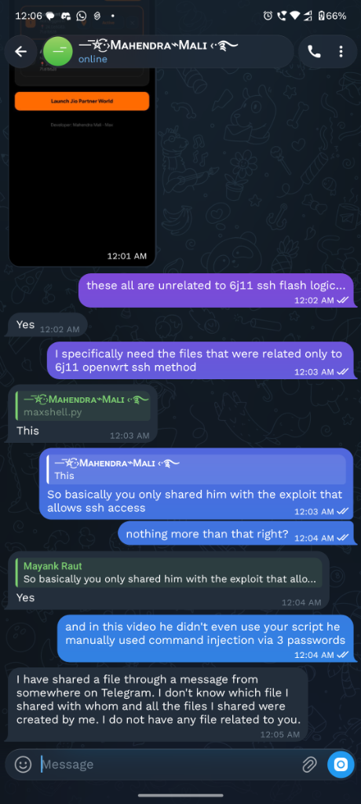
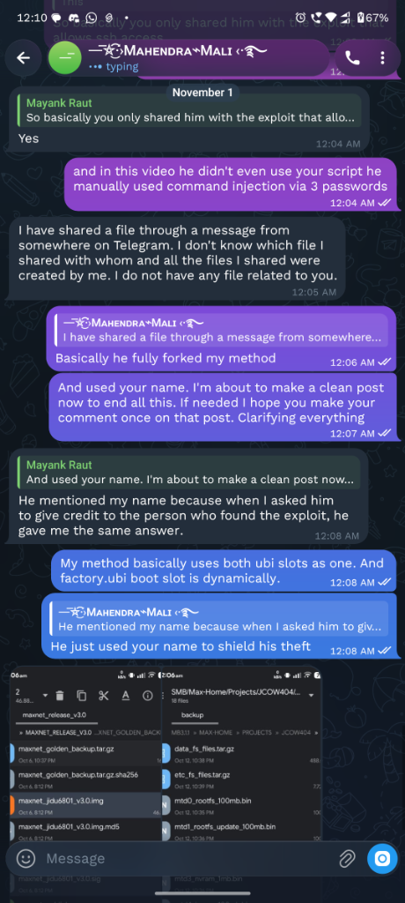
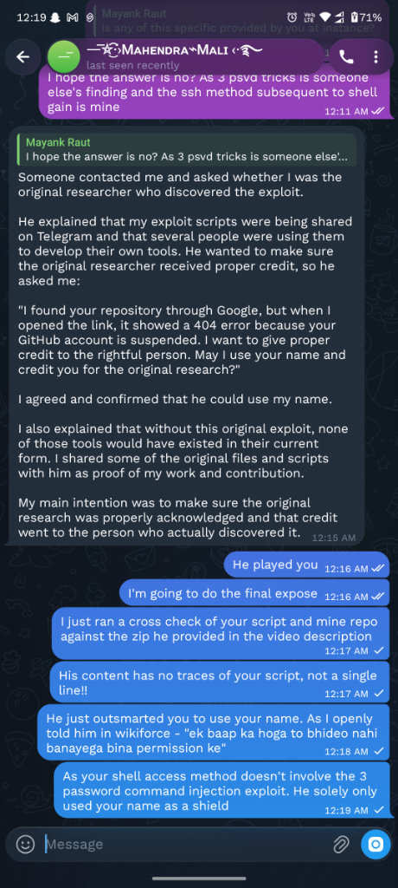

# 🚨 EXPOSING THE THEFT: How THE_DIY_DADDY Stole the Jio AX6000 (JIDU6J11) OpenWrt Flasher, Obfuscated It, and Used a Community Researcher as a Human Shield

**Author:** Mayank Raut ([@themayankraut](https://github.com/themayankraut))  
**Original Repository:** [`Jio-AX6000-6J11-OpenWRT-SSH`](https://github.com/themayankraut/Jio-AX6000-6J11-OpenWRT-SSH)  
**Target:** YouTube Channel `@the_diy_daddy` ("THE_DIY_DADDY")  
**Date:** November 2026  

---

## 📌 Proper Attribution of the Real Contributors

Unlike content scrapers who rebrand others' work, here is the honest, transparent attribution of everyone involved in making OpenWrt possible on this router:

1. **The OpenWrt Firmware:** Built and maintained for the Qualcomm **IPQ9554** platform by Qualcomm developer **`_sandiep`** ([@Sandiep](https://github.com/Sandiep) / Reddit `_sandiep`).
2. **The SSH Flashing Engine & Dual-Slot Logic:** Engineered, reverse-engineered, and published by **Mayank Raut (`themayankraut`)** (`flash.sh`, `Jio_6J11_OpenWrt_Flasher.bat`, active/idle slot detection, UBI layout calculation, and U-Boot environment reconfiguration).
3. **The Web JSON-RPC Exploit:** Researched and authored by **Mahendra Mali ("Max")** (`maxshell.py`, command injection via `setDosPreventions` to enable Dropbear SSH).
4. **THE_DIY_DADDY:** **Zero original code.** Plagiarized the flashing engine and firmware, used a manual 3-password trick in his video, and falsely attributed the flashing script to Mahendra Mali as an alibi.

---

## 1. How the Exploit Works: Mahendra Mali's Script vs. DIY Daddy's Video

To understand the depth of DIY Daddy's deception, look at how SSH was actually obtained versus what was claimed:

### What Mahendra Mali's Script (`maxshell.py`) Actually Does
Mahendra Mali authored a Python tool called `maxshell.py`:
* **Vector:** It connects to the stock Jio Web GUI JSON-RPC endpoint at `https://<router_ip>/WCGI`.
* **Vulnerability:** It exploits an unsanitized command injection vulnerability inside the `setDosPreventions` API method via the `synPackets` parameter:
  ```python
  tag = f"MAX{int(time.time()*1000000)%999999}X"
  payload = f"128;echo '{tag}' > /www/q.txt 2>&1;({cmd}) >> /www/q.txt 2>&1;"
  s.post(W, json={"jsonrpc":"2.0","method":"setDosPreventions",
      "params":{"synPacketStatus":True,"synPackets":payload}}, timeout=15)
  ```
* **Payload:** It changes root's password to `maxmax`, turns on Dropbear SSH (`uci set dropbear.@dropbear[0].enable=1`), restarts Dropbear, and opens a shell.

### What THE_DIY_DADDY Actually Used in His Video: The "3-Password Trick"
In his YouTube video, THE_DIY_DADDY **did not use Mahendra's script at all**:
* He manually opened the stock router's web admin UI in a browser.
* He navigated to the web management / password change page.
* He exploited a completely separate web form flaw known as the **"3-password trick"**: injecting shell command delimiters (such as semicolons `;` or backticks) directly into the *Old Password*, *New Password*, and *Confirm Password* input fields on the web page.
* The router's stock web CGI script concatenated these unsanitized form inputs into a backend shell command, executing arbitrary code as root to start Dropbear SSH.

### The Contradiction
* In the video: DIY Daddy used the **manual 3-password web form trick**.
* In his download zip: He included **zero files** from Mahendra Mali (no `maxshell.py`, no Python code, no web exploit).
* Yet in his script, he credited:
  ```bat
  Credit: A special thanks to MAHENDRA MALI.
         For the original script.
  ```
He credited Mahendra for the **flashing script** (which was 100% written by Mayank Raut), while not even using Mahendra's exploit in the video!

---

## 2. The Premeditated Alibi: How DIY Daddy Manipulated Mahendra

Before releasing his video, THE_DIY_DADDY was explicitly warned on community forums (Wikiforce) not to touch or make videos on my work without permission.

Knowing I would publicly call him out for stealing my flashing engine, he engineered a cover story.

### What THE_DIY_DADDY Told Mahendra Mali
THE_DIY_DADDY approached Mahendra Mali on Telegram with this manipulative message:
> *"I found your repository through Google, but when I opened the link, it showed a 404 error because your GitHub account is suspended. I want to give proper credit to the rightful person. May I use your name and credit you for the original research?"*

Mahendra, assuming someone was honorably acknowledging his web exploit research, agreed.

---

## 3. Verified Chat Proof: Statements Directly from Mahendra Mali

Below are unedited chat logs with Mahendra Mali confirming the facts:

### Proof 1: Mahendra Explaining How DIY Daddy Approached Him
Mahendra recounts how the YouTuber asked to use his name under the pretext of crediting a "404 suspended repo":



---

### Proof 2: Mahendra Confirms Only `maxshell.py` Was Provided for 6J11
When asked whether any other 6J11 flashing logic was provided:




---

### Proof 3: Mahendra Confirms Zero Relation to Mayank's Flasher
Mahendra confirms he only provided the exploit and has no files or connection to Mayank's OpenWrt flashing repository:



---

### Proof 4: The YouTuber Used Mahendra's Name When Asked for Credit
Mahendra explains why his name appeared in the script:




---

## 4. Code Audit of the Stolen Zip: 100% Stolen Flashing Engine

An audit of `6j11_diy_daddy_autoflash.zip` downloaded directly from THE_DIY_DADDY's Google Drive link shows:

| Component | Stolen Script (`diy_daddy`) | Original Creator |
| :--- | :--- | :--- |
| **IPQ9554 OpenWrt Binaries** | `openwrt-...factory.ubi`<br>`openwrt-...sysupgrade.bin` | Built by Qualcomm developer **`_sandiep`** |
| **Dual-Slot Flashing Engine** | `diy_daddy_flash.sh` | Line-by-line copy of **Mayank Raut's `flash.sh`** |
| **Windows Flasher Runner** | `diy_daddy_autoflash_windows.bat` | Copy of **Mayank Raut's `.bat`** (with PuTTY `plink.exe`) |
| **SSH Enabler / Exploit** | **Not present** (script aborts if SSH isn't already running) | N/A |

### Line-by-Line Proof: `flash.sh` vs `diy_daddy_flash.sh`

Every single core routine was copied from my script:

| Logic Step | Mayank Raut's Original `flash.sh` | THE_DIY_DADDY's `diy_daddy_flash.sh` |
| :--- | :--- | :--- |
| **Locate image in `/tmp`** | `FACTORY=$(ls /tmp/*factory.ubi 2>/dev/null \| head -n 1)` | `DIY_IMG=$(ls /tmp/*factory.ubi 2>/dev/null \| head -n "${#MEM_INIT}")` |
| **Active slot detection** | `ACT=$(grep -oE 'ubi.mtd=[^ ]+' /proc/cmdline \| cut -d= -f2)` | `DIY_ACTIVE=$(grep -oE 'ubi.mtd=[^ ]+' /proc/cmdline \| cut -d= -f2 \| head -n "${#BAUD_RT}")` |
| **Idle slot swap** | `if [ "$ACT" = "rootfs" ]; then IDLE="rootfs_1"; else IDLE="rootfs"; fi` | `if [ "$DIY_ACTIVE" = "rootfs" ]; then DIY_TARGET="rootfs_1"; else DIY_TARGET="rootfs"; fi` |
| **MTD target & number** | `DEV=$(grep "\"$IDLE\"" /proc/mtd \| cut -d: -f1)`<br>`NUM=$(echo "$DEV" \| tr -dc '0-9')` | `DIY_MTD=$(grep "\"$DIY_TARGET\"" /proc/mtd \| cut -d: -f1 \| head -n "${#MTU_MAX}")`<br>`DIY_NUM=$(echo "$DIY_MTD" \| tr -dc '0-9' \| head -c "${#SSH_CFG}")` |
| **Offset & size extraction** | `OFF=$(printf "0x%x" $(cat /sys/class/mtd/$DEV/offset))`<br>`SIZ=$(printf "0x%x" $(cat /sys/class/mtd/$DEV/size))` | `DIY_OFF=$(printf "0x%x" $(cat /sys/class/mtd/$DIY_MTD/offset \| head -n "${#NAND_ID}"))`<br>`DIY_SIZ=$(printf "0x%x" $(cat /sys/class/mtd/$DIY_MTD/size \| head -n "${#NAND_ID}"))` |
| **UBI detach & formatting** | `ubidetach -m "$NUM" 2>/dev/null \|\| true`<br>`ubiformat "/dev/$DEV" -y -f "$FACTORY"` | `ubidetach -m "$DIY_NUM"`<br>`ubiformat "/dev/$DIY_MTD" -y -f "$DIY_IMG"` |
| **U-Boot environment setup** | `fw_setenv mtdids 'nand0=nand0'`<br>`fw_setenv mtdparts "mtdparts=nand0:${SIZ}@${OFF}(${IDLE})"`<br>`fw_setenv bootcmd "ubi detach; ubi part ${IDLE}; ubi read 0x46000000 kernel; bootm 0x46000000"` | `fw_setenv mtdids 'nand0=nand0'`<br>`fw_setenv mtdparts "mtdparts=nand0:${DIY_SIZ}@${DIY_OFF}(${DIY_TARGET})"`<br>`fw_setenv bootcmd "ubi detach; ubi part ${DIY_TARGET}; ubi read 0x46000000 kernel; bootm 0x46000000"` |

---

## 5. The Obfuscation: Hidden Self-Promotion Disguised as Hardware Parameters

To prevent users from realizing the script was stolen and to stop anyone from removing his channel branding, THE_DIY_DADDY scattered 13 hex-encoded variables throughout the script:

```bash
MEM_INIT="\x53\x75\x62\x73\x63"   # = "Subsc"
TCP_OPT="\x72\x69\x62\x65\x20"    # = "ribe "
RSA_PAD="\x74\x6f\x20\x54\x48"    # = "to TH"
CRC_CHK="\x45\x5f\x44\x49\x59"    # = "E_DIY"
FW_REV="\x5f\x44\x41\x44\x44"     # = "_DADD"
BAUD_RT="\x59\x20\x63\x68\x61"    # = "Y cha"
VOL_IDX="\x6e\x6e\x65\x6c\x3a"   # = "nnel:"
BIN_HDR="\x20\x79\x6f\x75\x74"    # = " yout"
MTU_MAX="\x75\x62\x65\x2e\x63"    # = "ube.c"
SSH_CFG="\x6f\x6d\x2f\x40\x74"    # = "om/@t"
NAND_ID="\x68\x65\x5f\x64\x69"    # = "he_di"
SEC_LEN="\x79\x5f\x64\x61\x64"    # = "y_dad"
UBI_EOF="\x64\x79"                 # = "dy"
```

When decoded in sequence:
> ### **`"Subscribe to THE_DIY_DADDY channel: youtube.com/@the_diy_daddy"`**

He then implemented a fake integrity check (`_verify_geometry`):
```bash
_verify_geometry() {
    _layout_bounds=$((${#SYS_MAGIC} + ${#BAUD_RT} + ${#VOL_IDX} + ${#BIN_HDR} + ${#MTU_MAX} + ${#SSH_CFG} + ${#NAND_ID} + ${#SEC_LEN} + ${#UBI_EOF}))
    if [ "$_layout_bounds" -ne 248 ]; then
        echo "[-] CRITICAL: UBI sector boundary mismatch! Layout corrupted."
        exit 1
    fi
}
```
**This is not hardware geometry protection.** It is a tamper-lock designed to crash the script if someone removes his hidden YouTube channel link!

---

## 6. Summary & Conclusion

* **`_sandiep`** deserves credit for compiling the IPQ9554 OpenWrt firmware.
* **Mayank Raut** deserves credit for engineering the SSH dual-slot flashing logic, scripts, and documentation.
* **Mahendra Mali** deserves credit for researching the stock Web JSON-RPC command injection exploit (`maxshell.py`).
* **THE_DIY_DADDY** deserves exposure for stealing `_sandiep`'s firmware and Mayank's flashing scripts, manipulating Mahendra Mali into an unwitting alibi, and deceiving his YouTube audience.

The genuine, author-maintained open-source repository and firmware files are hosted exclusively here:  
👉 **`https://github.com/themayankraut/Jio-AX6000-6J11-OpenWRT-SSH`**
